<div class="ctf-hero">
  <h1>Smol — TryHackMe</h1>
  <p>
    A technical penetration testing case study documenting the exploitation
    of a WordPress application and the subsequent compromise of a Linux host
    in a controlled TryHackMe Capture The Flag environment.
  </p>
  <div class="ctf-badges">
    <span class="ctf-badge">TryHackMe</span>
    <span class="ctf-badge">Intermediate</span>
    <span class="ctf-badge">Linux</span>
    <span class="ctf-badge">WordPress</span>
    <span class="ctf-badge">LFI</span>
    <span class="ctf-badge">RCE</span>
    <span class="ctf-badge">Privilege Escalation</span>
  </div>
</div>

# Mission

This case study documents the assessment of the **Smol** TryHackMe room. The engagement follows the documented attack path from external reconnaissance through WordPress exploitation, credential discovery, SSH-based user pivoting, and root privilege escalation.

The emphasis is on understanding how weaknesses across application code, configuration management, credential storage, backup handling, and Linux privilege delegation can combine to produce a complete host compromise.

Sensitive credentials, password hashes, private keys, and challenge flags are intentionally redacted in this portfolio version. Original evidence paths are retained.

<div class="callout info">
  <div class="callout-title">Assessment Scope</div>
  This write-up describes activity in a controlled cybersecurity training
  environment. The target IP address, exact service versions, recovered
  secret values, and other details not provided in the source are not
  reconstructed.
</div>

## Quick Overview

<div class="ctf-card-grid">
  <div class="ctf-card">
    <div class="ctf-card-title">Platform</div>
    <div class="ctf-card-value">TryHackMe</div>
  </div>
  <div class="ctf-card">
    <div class="ctf-card-title">Target</div>
    <div class="ctf-card-value">Smol — Linux / WordPress</div>
  </div>
  <div class="ctf-card">
    <div class="ctf-card-title">Reported Difficulty</div>
    <div class="ctf-card-value">Intermediate</div>
  </div>
  <div class="ctf-card">
    <div class="ctf-card-title">Initial Attack Vector</div>
    <div class="ctf-card-value">WordPress Plugin LFI</div>
  </div>
  <div class="ctf-card">
    <div class="ctf-card-title">Execution Path</div>
    <div class="ctf-card-value">PHP Backdoor / RCE</div>
  </div>
  <div class="ctf-card">
    <div class="ctf-card-title">Final Objective</div>
    <div class="ctf-card-value">Root Access</div>
  </div>
</div>

## Assessment Objectives

- Identify exposed network services and fingerprint the target.
- Enumerate the WordPress installation, plugins, users, and application endpoints.
- Investigate the reported `jsmol2wp` Local File Inclusion vulnerability.
- Examine the disclosed configuration and the reported PHP backdoor in the Hello Dolly plugin.
- Validate operating-system command execution and obtain an interactive shell.
- Investigate database authentication material, password hashes, SSH keys, and backup archives.
- Document SSH-based lateral movement and the reported sudo-based privilege escalation.
- Derive defensive recommendations from the documented attack path.

## Navigation

<div class="ctf-toc">
  <div class="ctf-toc-title">Documentation Map</div>
  <ul>
    <li><a href="#mission">Mission</a></li>
    <li><a href="#quick-overview">Quick Overview</a></li>
    <li><a href="#assessment-objectives">Assessment Objectives</a></li>
    <li><a href="#target-and-lab-information">Target and Lab Information</a></li>
    <li><a href="#skills-and-tools">Skills and Tools</a></li>
    <li><a href="#attack-chain">Attack Chain</a></li>
    <li><a href="#phase-i--external-reconnaissance">Phase I — External Reconnaissance</a></li>
    <li><a href="#phase-ii--web-enumeration">Phase II — Web Enumeration</a></li>
    <li><a href="#phase-iii--wordpress-enumeration">Phase III — WordPress Enumeration</a></li>
    <li><a href="#phase-iv--local-file-inclusion">Phase IV — Local File Inclusion</a></li>
    <li><a href="#phase-v--backdoor-analysis">Phase V — Backdoor Analysis</a></li>
    <li><a href="#phase-vi--remote-code-execution">Phase VI — Remote Code Execution</a></li>
    <li><a href="#phase-vii--interactive-shell">Phase VII — Interactive Shell</a></li>
    <li><a href="#phase-viii--credential-harvesting">Phase VIII — Credential Harvesting</a></li>
    <li><a href="#phase-ix--offline-password-analysis">Phase IX — Offline Password Analysis</a></li>
    <li><a href="#phase-x--ssh-lateral-movement">Phase X — SSH Lateral Movement</a></li>
    <li><a href="#phase-xi--backup-analysis">Phase XI — Backup Analysis</a></li>
    <li><a href="#phase-xii--additional-user-discovery">Phase XII — Additional User Discovery</a></li>
    <li><a href="#phase-xiii--privilege-escalation">Phase XIII — Privilege Escalation</a></li>
    <li><a href="#consolidated-findings">Consolidated Findings</a></li>
    <li><a href="#mitre-attck-context">MITRE ATT&amp;CK Context</a></li>
    <li><a href="#defensive-recommendations">Defensive Recommendations</a></li>
    <li><a href="#lessons-learned">Lessons Learned</a></li>
    <li><a href="#references">References</a></li>
    <li><a href="#repository-contents">Repository Contents</a></li>
    <li><a href="#responsible-use">Responsible Use</a></li>
  </ul>
</div>

## Target and Lab Information

| Assessment Item | Documented Information |
|---|---|
| Platform | TryHackMe |
| Room | Smol |
| Assessment type | Black-box web application assessment with post-exploitation |
| Primary technology | WordPress |
| Operating system | Linux |
| Web stack | Apache and PHP, as reported in the original notes |
| Initial attack vector | Local File Inclusion in the `jsmol2wp` plugin |
| Subsequent execution path | Reported PHP backdoor in Hello Dolly |
| Lateral movement | SSH authentication using discovered authentication material |
| Privilege escalation | Reported excessive sudo permissions |
| Final objective | Root access |
| Environment | Controlled training laboratory |

The source uses `TARGET_IP` as a placeholder rather than supplying a specific address. No target IP, port number, exact service version, or hostname is inferred here.

## Skills and Tools

<div class="ctf-card-grid">
  <div class="ctf-card">
    <div class="ctf-card-title">Reconnaissance</div>
    <div class="ctf-card-value">Nmap, service fingerprinting, HTTP enumeration</div>
  </div>
  <div class="ctf-card">
    <div class="ctf-card-title">Web Enumeration</div>
    <div class="ctf-card-value">Gobuster, robots.txt, WordPress discovery</div>
  </div>
  <div class="ctf-card">
    <div class="ctf-card-title">CMS Assessment</div>
    <div class="ctf-card-value">WPScan, plugin and user enumeration</div>
  </div>
  <div class="ctf-card">
    <div class="ctf-card-title">Exploitation</div>
    <div class="ctf-card-value">LFI analysis, PHP backdoor review, RCE validation</div>
  </div>
  <div class="ctf-card">
    <div class="ctf-card-title">Post-Exploitation</div>
    <div class="ctf-card-value">Netcat, Python PTY, filesystem and credential review</div>
  </div>
  <div class="ctf-card">
    <div class="ctf-card-title">Privilege Escalation</div>
    <div class="ctf-card-value">SSH, sudo review, backup analysis, John / Hashcat methodology</div>
  </div>
</div>

| Tool | Documented purpose |
|---|---|
| Nmap | Network discovery, service detection, and initial fingerprinting |
| Gobuster | Web directory enumeration |
| WPScan | WordPress user, plugin, and theme enumeration |
| Netcat | Reverse-shell listener |
| Python | Pseudo-terminal (PTY) stabilization |
| SSH | Remote user authentication and pivoting |
| John / Hashcat | Offline password-recovery methodology |
| `zipinfo` / `unzip` | Backup archive inspection and extraction |

## Attack Chain

<div class="attack-chain">
  <div class="attack-step">Reconnaissance</div>
  <div class="attack-arrow">→</div>
  <div class="attack-step">WordPress Enumeration</div>
  <div class="attack-arrow">→</div>
  <div class="attack-step">Plugin LFI</div>
  <div class="attack-arrow">→</div>
  <div class="attack-step">Configuration Disclosure</div>
  <div class="attack-arrow">→</div>
  <div class="attack-step">PHP Backdoor / RCE</div>
  <div class="attack-arrow">→</div>
  <div class="attack-step">Interactive Shell</div>
  <div class="attack-arrow">→</div>
  <div class="attack-step">Credential Discovery</div>
  <div class="attack-arrow">→</div>
  <div class="attack-step">SSH Pivot</div>
  <div class="attack-arrow">→</div>
  <div class="attack-step">Backup Analysis</div>
  <div class="attack-arrow">→</div>
  <div class="attack-step">sudo Abuse</div>
  <div class="attack-arrow">→</div>
  <div class="attack-step">Root</div>
</div>

The source describes this end-to-end progression. Individual evidence artifacts are retained below, while sensitive values remain redacted.

## Terminal Banner

The original notes included the following high-level assessment transcript:

```text
┌──(anurag㉿cybersecurity)-[~/TryHackMe/Smol]
└─$ python3 exploit.py

[+] Target Identified
[+] WordPress Enumeration Complete
[+] Local File Inclusion Confirmed
[+] Configuration Disclosure Successful
[+] Remote Code Execution Established
[+] Interactive Reverse Shell Acquired
[+] Credentials Harvested
[+] SSH Pivot Successful
[+] Privilege Escalation Complete

root@smol:/#
```

This is a summary transcript from the source documentation, not a substitute for the individual command output or independently verified evidence.

---

## Phase I — External Reconnaissance

The assessment began by identifying exposed services and determining which service offered the most promising application-level attack surface.

### Figure 02 — Network Enumeration

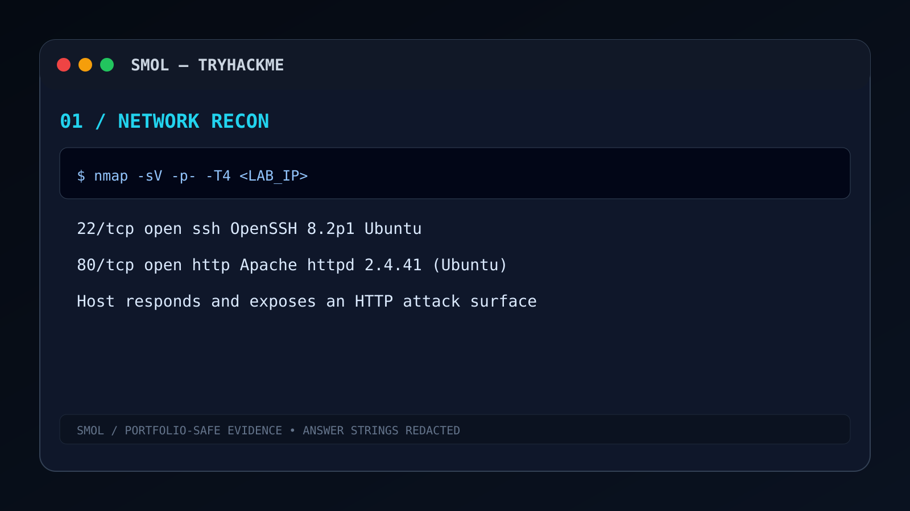

*Figure 02. Initial TCP service enumeration and operating-system fingerprinting, as described in the source documentation.*

### Network scan

The source records the following command:

```bash
nmap -sC -sV -Pn TARGET_IP
```

**Purpose**

- `-sC` runs Nmap's default script set.
- `-sV` attempts service and version detection.
- `-Pn` skips host discovery and treats the target as online for scanning.

The original notes report HTTP and SSH services and identify a Linux host. They do not include the complete raw Nmap output, exact ports, or detected version strings.

### Reported observations

| Observation | Assessment relevance |
|---|---|
| HTTP service | Primary application attack surface |
| Apache and PHP indicators | Support targeted web-stack investigation |
| WordPress indicators | Justify CMS-specific enumeration |
| SSH service | Potential remote authentication path |
| Linux host | Establishes the context for later Linux privilege-escalation analysis |

The web service was prioritized because the reported WordPress application exposed a broader application-level attack surface than the initial service inventory alone revealed.

### Reconnaissance evidence

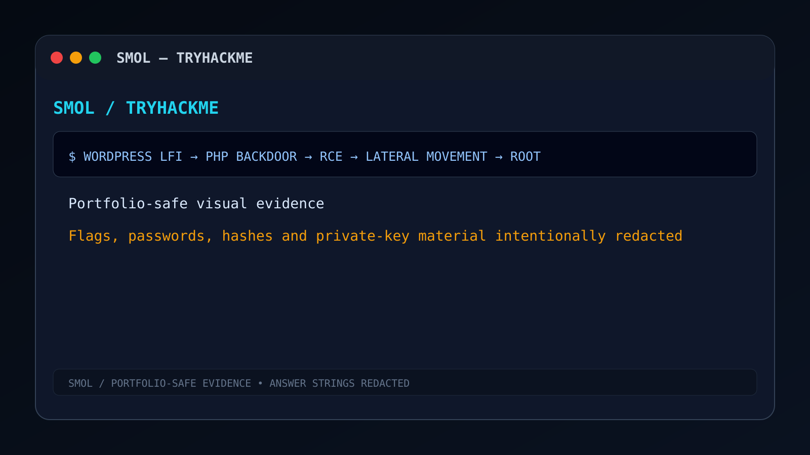

*Figure 01. Original cover illustration retained from the source repository.*

### Defensive perspective

A limited number of exposed network services does not imply a low-risk system. Web applications, third-party plugins, and administrative functionality can introduce significant risk even when the network-facing footprint appears small.

---

## Phase II — Web Enumeration

The next phase investigated the WordPress application for administrative endpoints, directories, plugin resources, and other publicly accessible paths.

### Figure 03 — Directory Enumeration

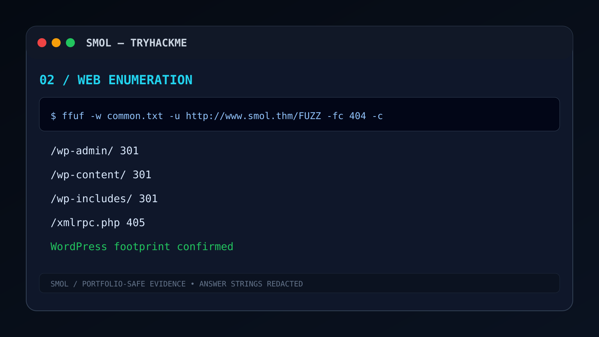

*Figure 03. Web directory enumeration, as documented in the original walkthrough.*

### Gobuster command

```bash
gobuster dir -u http://TARGET_IP \
-w common.txt
```

The command uses Gobuster's directory-enumeration mode against the HTTP application with `common.txt` as the wordlist.

The source lists the following discovered paths:

```text
/wp-admin
/wp-login.php
/wp-content
/wp-includes
/robots.txt
/xmlrpc.php
```

These paths indicate common WordPress administrative, authentication, content, core-library, and remote-procedure-call surfaces. Their discovery does not, by itself, establish that every endpoint is vulnerable.

### Enumeration findings

| Path | Purpose in the assessment |
|---|---|
| `/wp-admin` | WordPress administration interface |
| `/wp-login.php` | Authentication endpoint |
| `/wp-content` | Plugin, theme, and upload resources |
| `/wp-includes` | WordPress core libraries |
| `/robots.txt` | Public indexing instructions and possible reconnaissance clues |
| `/xmlrpc.php` | WordPress XML-RPC functionality |

### robots.txt review

The original notes report that `robots.txt` exposed indexing rules and helped confirm parts of the WordPress directory structure. This is treated as a reconnaissance observation, not an independently established vulnerability.

### Result

The application was identified as WordPress, allowing the assessment to move from general directory enumeration to targeted CMS and plugin analysis.

---

## Phase III — WordPress Enumeration

WordPress plugin code was the primary focus because third-party components can expose vulnerable functionality that is not present in the core CMS.

### Figure 04 — WPScan Enumeration

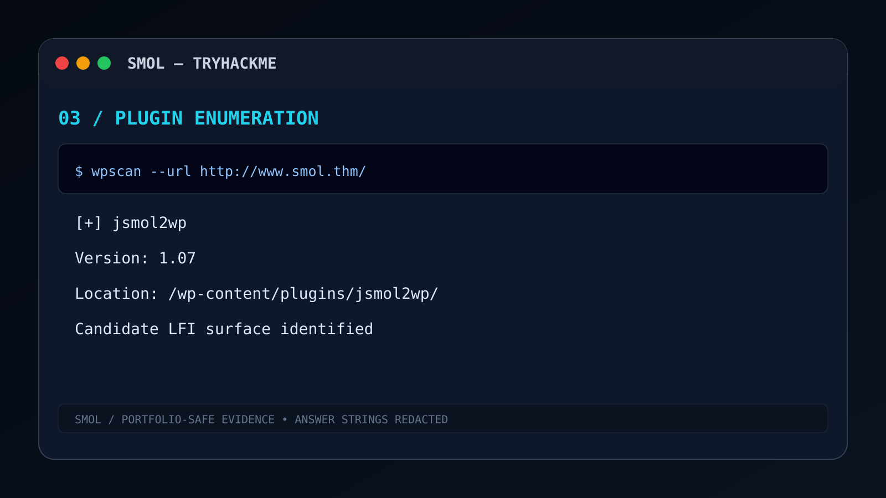

*Figure 04. WordPress plugin enumeration and vulnerability discovery, as documented in the source.*

### WPScan command

```bash
wpscan --url http://TARGET_IP --enumerate u,p,t
```

The documented enumeration targets are:

- `u` — users
- `p` — plugins
- `t` — themes

The source reports that publicly discoverable users, installed plugins, theme information, and the XML-RPC endpoint were investigated.

### Primary finding: `jsmol2wp`

<div class="key-finding">
  <div class="key-finding-title">Plugin Vulnerability</div>
  The source identifies the WordPress plugin `jsmol2wp` as the initial
  exploitation vector and reports a Local File Inclusion (LFI) vulnerability.
  The following phase documents the reported configuration disclosure.
</div>

### Why plugin enumeration matters

| Condition | Potential security consequence |
|---|---|
| Outdated plugin | Exposure to known, unpatched vulnerabilities |
| Custom plugin code | Application-specific security defects |
| Unsafe file handling | Local file disclosure or traversal |
| Unauthorized plugin modification | Malicious functionality or server-side execution |

### User enumeration and XML-RPC

The original documentation reports user enumeration and review of XML-RPC availability. It does not publish the recovered usernames in this portfolio version.

XML-RPC was identified as additional attack surface but was not reported as a directly exploited component in this assessment.

### Result

The `jsmol2wp` plugin became the primary focus for active exploitation.

---

## Phase IV — Local File Inclusion

The source reports that the `jsmol2wp` plugin allowed local file disclosure and that the WordPress configuration file was subsequently exposed.

### Figure 05 — LFI and Configuration Disclosure

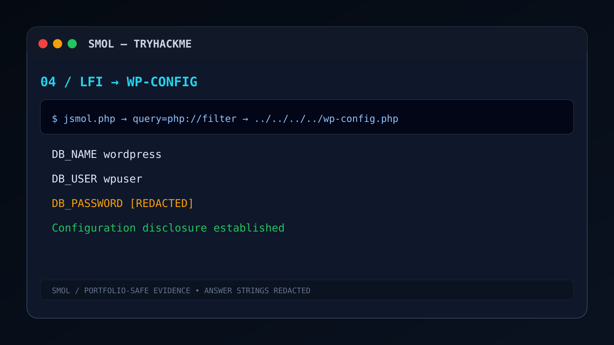

*Figure 05. Reported Local File Inclusion and WordPress configuration disclosure. Sensitive values remain redacted.*

### Vulnerability explanation

Local File Inclusion occurs when an application uses an insufficiently validated user-controlled path to include or retrieve a local file. Depending on the implementation and execution context, this can expose configuration files or other sensitive filesystem content.

In this case, the source identifies the vulnerable plugin as `jsmol2wp` and reports disclosure of `wp-config.php`.

### Reported exploitation flow

<div class="attack-chain">
  <div class="attack-step">HTTP Request</div>
  <div class="attack-arrow">→</div>
  <div class="attack-step">Plugin File Handling</div>
  <div class="attack-arrow">→</div>
  <div class="attack-step">Local File Inclusion</div>
  <div class="attack-arrow">→</div>
  <div class="attack-step">wp-config.php</div>
  <div class="attack-arrow">→</div>
  <div class="attack-step">Configuration Disclosure</div>
</div>

The original source does not include the exact vulnerable URL, parameter name, or complete exploitation request. Those details are therefore not reconstructed.

### Why `wp-config.php` matters

WordPress configuration can contain sensitive database connection information and authentication-related secrets.

| Configuration area | Potential impact if exposed |
|---|---|
| Database name | Reveals application data architecture |
| Database username | Exposes a database account identifier |
| Database password | May enable unauthorized database access |
| Authentication salts and keys | Can weaken trust in existing authentication material if compromised |
| Table prefix | Reveals database naming information |
| Filesystem configuration | May expose installation details |

The source reports recovering database credentials, authentication salts, and filesystem information. The actual secret values are intentionally withheld.

### Security impact

<div class="callout warning">
  <div class="callout-title">Configuration Exposure</div>
  File disclosure can cross trust boundaries without immediately providing
  operating-system command execution. Database credentials and authentication
  secrets can create additional compromise paths when they are accessible
  and remain valid.
</div>

### Defensive controls

- Validate and canonicalize file paths before use.
- Restrict file access to explicitly permitted directories.
- Patch or remove the vulnerable plugin.
- Store application secrets with appropriate access controls.
- Monitor suspicious path traversal and file-access requests.
- Rotate credentials and secrets exposed during an incident.

---

## Phase V — Backdoor Analysis

After configuration disclosure, the original walkthrough describes further investigation of installed plugin files and the discovery of unexpected PHP functionality in the Hello Dolly plugin.

### Figure 06 — PHP Backdoor Source

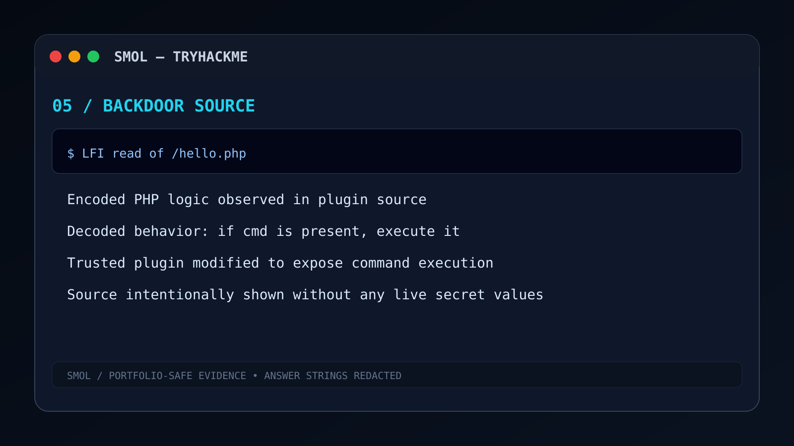

*Figure 06. Source-code analysis of the reported hidden PHP functionality. Sensitive payload content has been removed.*

### Plugin integrity investigation

The original documentation describes manual inspection of plugin source files, focusing on:

| Inspection area | Reason |
|---|---|
| Plugin entry file | Identify unexpected execution logic |
| Included PHP files | Find functionality outside the expected plugin behavior |
| HTTP parameters | Understand how external input reaches server-side code |
| Command-handling logic | Determine whether operating-system interaction is possible |

### Reported execution model

```text
Authenticated Request
        |
        v
Hidden Plugin Functionality
        |
        v
PHP Request Parameter
        |
        v
Operating-System Command
        |
        v
Command Output
```

The source characterizes the functionality as a PHP backdoor capable of operating-system command execution. The exact PHP source, request parameter, and payload are intentionally not reproduced because they are not present in the supplied documentation.

### Security significance

Unexpected server-side command execution in a web application can allow an attacker to read sensitive files, execute processes, and establish further access within the permissions of the web server account.

The source reports that the backdoor was the subsequent execution path. This should be distinguished from the earlier LFI vulnerability: the documented LFI exposed configuration, while the reported backdoor provided command-execution functionality.

### Defensive controls

- Compare deployed plugin files against trusted, known-good versions.
- Investigate unauthorized changes to plugin source code.
- Restrict who can install or modify plugins.
- Monitor unexpected PHP execution and suspicious process creation.
- Review administrative activity and file-integrity events.
- Remove malicious code and restore trusted application files after investigation.

---

## Phase VI — Remote Code Execution

The source reports that the hidden PHP functionality was used to validate operating-system command execution under the web server's security context.

### Figure 07 — Command Execution Validation

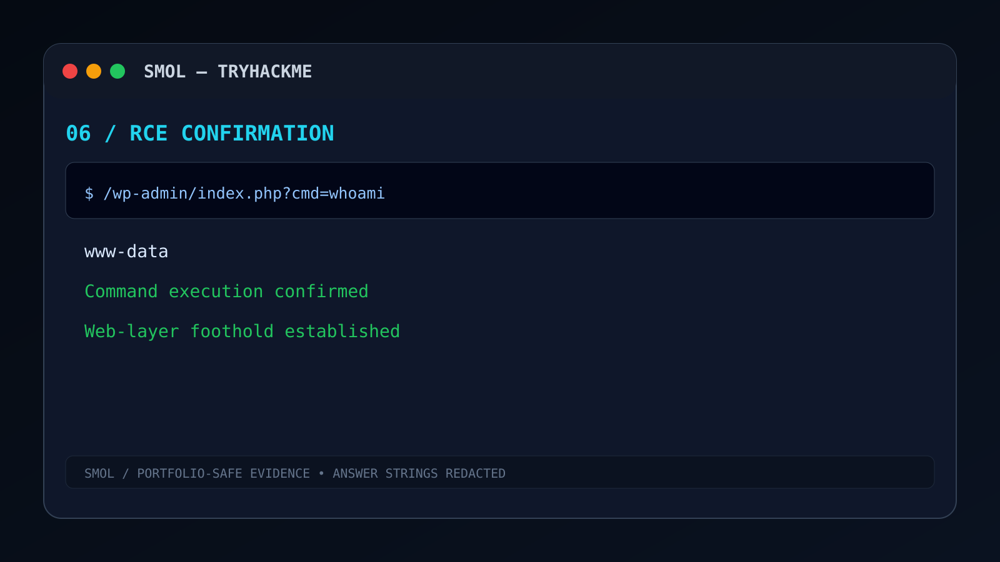

*Figure 07. Reported validation of operating-system command execution through the PHP backdoor.*

### Validation commands

The original notes list the following low-impact commands:

```bash
whoami
id
hostname
pwd
uname -a
```

| Command | Purpose |
|---|---|
| `whoami` | Identify the effective username |
| `id` | Display user and group identity information |
| `hostname` | Identify the system hostname |
| `pwd` | Display the current working directory |
| `uname -a` | Display kernel and system information |

The source reports that command execution was validated as the web server user and that the Linux environment and working directory were investigated.

The original notes do not provide the full output for these commands, so specific usernames, group IDs, kernel versions, and directory paths are not inferred.

### Reported result

<div class="key-finding">
  <div class="key-finding-title">Remote Command Execution</div>
  The source reports successful operating-system command execution through
  the discovered PHP functionality. This created the documented path from
  web application compromise to Linux post-exploitation.
</div>

### Defensive considerations

Command execution from a web application should be treated as a high-impact incident. Investigators should review web-server process activity, unexpected child processes, filesystem access, and outbound network connections. Remediation should include removal of the execution path and rotation of potentially exposed secrets.

---

## Phase VII — Interactive Shell

The source reports that remote command execution was followed by an interactive reverse shell, allowing more extensive filesystem and user-context investigation.

### Figure 08 — Reverse Shell

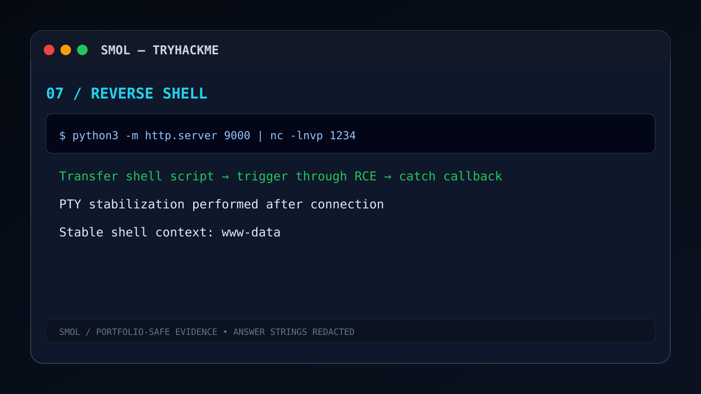

*Figure 08. Interactive shell evidence retained from the original documentation.*

### Reported shell workflow

```text
Attacker Listener
       ^
       | TCP Connection
       |
Target Web Server
       |
       v
PHP Backdoor
       |
       v
Interactive Bash Shell
```

The source identifies Netcat as the listener tool and reports a stable shell session. The target address, listener port, and exact reverse-shell payload were not supplied and are not fabricated here.

### PTY stabilization

The original walkthrough documents the following terminal commands:

```bash
python3 -c 'import pty; pty.spawn("/bin/bash")'
```

```bash
export TERM=xterm
stty rows 40 columns 120
```

The Python command attempts to spawn Bash through a pseudo-terminal. Setting `TERM` and terminal dimensions can improve interactive terminal behavior.

### Post-exploitation enumeration

The source lists these commands for validating the shell context:

```bash
whoami
id
hostname
pwd
env
```

The reported post-exploitation workflow included:

- Filesystem traversal and readable-file discovery.
- Investigation of WordPress configuration and database authentication material.
- Review of user home directories.
- Search for SSH authentication material.
- Backup archive investigation.
- Preparation for further privilege escalation.

### Defensive considerations

Reverse-shell activity may be indicated by unexpected outbound connections, web-server processes spawning shells or scripting interpreters, and unusual process trees. Detection should combine network telemetry with endpoint and application-level logs.

---

## Phase VIII — Credential Harvesting

With an interactive shell available, the source describes investigating WordPress authentication records, configuration files, user home directories, and other locations containing potentially reusable authentication material.

### Figure 09 — WordPress Database Records

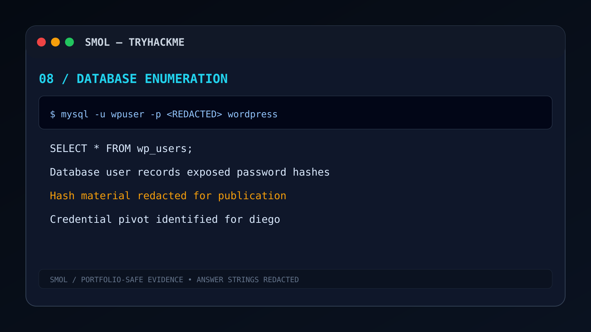

*Figure 09. WordPress authentication-record investigation. Password hashes are redacted.*

### Credential discovery workflow

<div class="attack-chain">
  <div class="attack-step">Interactive Shell</div>
  <div class="attack-arrow">→</div>
  <div class="attack-step">Filesystem Enumeration</div>
  <div class="attack-arrow">→</div>
  <div class="attack-step">Configuration Review</div>
  <div class="attack-arrow">→</div>
  <div class="attack-step">Database Investigation</div>
  <div class="attack-arrow">→</div>
  <div class="attack-step">Authentication Material</div>
</div>

### High-value locations

| Source | Potential security impact |
|---|---|
| WordPress database | Password hashes and user metadata |
| `wp-config.php` | Database credentials and authentication-related secrets |
| `/home/` | User accounts and potentially sensitive files |
| `/var/www/` | Application source code and configuration |
| `~/.ssh/` | SSH keys and related authentication configuration |
| Backup locations | Historical configuration and credentials |

These are the locations identified in the source documentation. Their listing should not be interpreted as proof that every file was accessible or contained a secret.

### Figure 10 — Offline Password Recovery

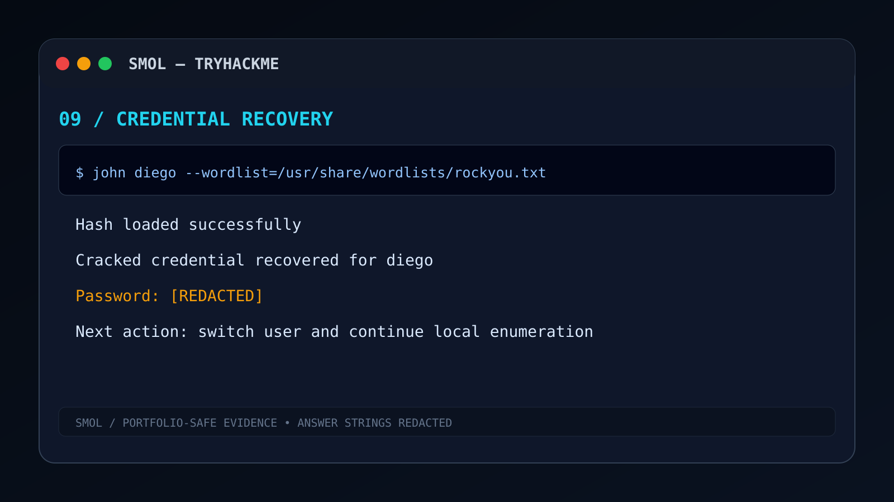

*Figure 10. Offline password-recovery evidence with password and hash values removed.*

The source reports extracting WordPress password hashes for offline analysis. It also describes credential recovery as part of the later SSH pivot. Actual usernames, hash strings, passwords, and recovered secret values remain redacted.

### Why credential exposure matters

Credential exposure can turn an application-level compromise into an identity compromise. The impact depends on the validity, privileges, scope, and reuse of the recovered authentication material.

### Defensive controls

- Restrict service-account access to configuration files.
- Use unique credentials across services and users.
- Rotate credentials exposed during a compromise.
- Protect database authentication records and backups.
- Review access to home directories and SSH-related files.
- Monitor unusual database access and file reads from web-server processes.

---

## Phase IX — Offline Password Analysis

The source describes offline analysis of password hashes and a password-protected archive. It names John and Hashcat as password-recovery tools.

### Documented methodology

```text
Password Hash or Protected Archive
              |
              v
       Offline Analysis
              |
              v
      Dictionary / Rule Testing
              |
              v
       Credential Recovery
              |
              v
   Authorized Authentication Review
```

Offline password analysis avoids sending repeated password guesses to a live authentication endpoint. It does not eliminate the need for authorization or safe handling of recovered secrets.

### Reported outcome

The source reports successful credential recovery and later authentication through SSH. The exact hash format, wordlist, tool invocation, password, and complete recovery output are not included in the supplied document and are not reconstructed.

### Security lessons

| Weak practice | Potential consequence |
|---|---|
| Weak passwords | Greater exposure to offline guessing |
| Password reuse | Compromise of additional accounts |
| Shared credentials | Expansion of the impact of a single leak |
| Unprotected hash exports | Additional offline attack opportunities |

### Recommended controls

- Enforce strong, unique passwords.
- Apply MFA where supported, particularly for administrative access.
- Rotate credentials that may have been exposed.
- Limit access to authentication databases and hash exports.
- Use secure password-hashing configurations appropriate to the application.

---

## Phase X — SSH Lateral Movement

The original notes report discovering SSH authentication material and using recovered credentials to authenticate into an additional Linux user account.

### Figure 11 — SSH Key Discovery

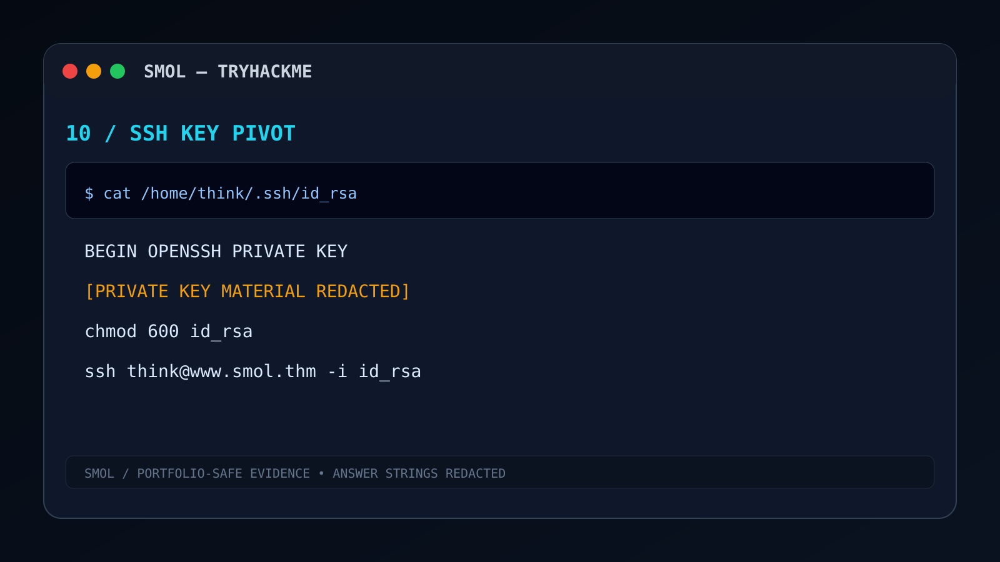

*Figure 11. SSH authentication material discovery. Private-key contents remain redacted.*

### Documented progression

<div class="attack-chain">
  <div class="attack-step">User Home Discovery</div>
  <div class="attack-arrow">→</div>
  <div class="attack-step">SSH Material Review</div>
  <div class="attack-arrow">→</div>
  <div class="attack-step">Permission Review</div>
  <div class="attack-arrow">→</div>
  <div class="attack-step">SSH Authentication</div>
  <div class="attack-arrow">→</div>
  <div class="attack-step">Additional User Shell</div>
</div>

### SSH artifacts reviewed

| Artifact | Security relevance |
|---|---|
| `id_rsa` | Private-key authentication material |
| `authorized_keys` | Public keys authorized for account access |
| `known_hosts` | Records of previously encountered SSH hosts |
| `config` | SSH client configuration and connection settings |

The source reports a successful SSH pivot and a stable user shell. It intentionally redacts the private key and does not provide the exact SSH command, target address, or authentication values.

### Security significance

SSH keys should be protected as credentials. A private key that becomes readable to an unintended account may permit authentication without a password, depending on the key's validity, restrictions, and server configuration.

### Defensive controls

- Apply strict ownership and permissions to SSH directories and keys.
- Use passphrases and managed keys where appropriate.
- Rotate or revoke exposed keys.
- Monitor successful SSH logins and unusual source addresses.
- Investigate attempts by web-server accounts to read users' SSH directories.
- Avoid sharing private keys across accounts or systems.

---

## Phase XI — Backup Analysis

The source describes locating a password-protected backup archive and analyzing its contents to recover historical configuration and authentication information.

### Figure 12 — Backup Discovery

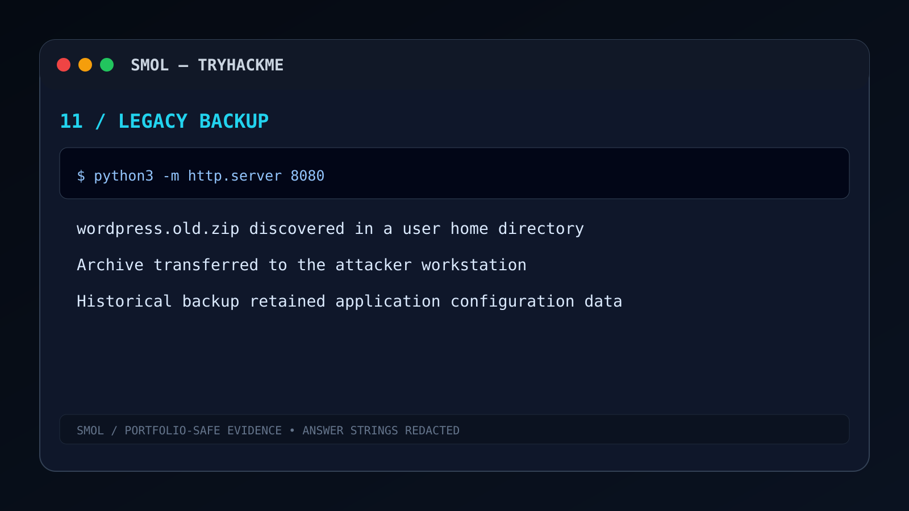

*Figure 12. Backup archive discovery and handling, as represented in the original evidence.*

### Why backup files are important

Backups may preserve information that is no longer required by the current application, including:

- Historical application configuration.
- Database exports.
- Old credentials and environment settings.
- Archived source code.
- Authentication material.

### Reported archive workflow

```text
Filesystem Enumeration
          |
          v
   Backup Archive Located
          |
          v
     Archive Inspection
          |
          v
  Offline Password Analysis
          |
          v
  Historical Files Reviewed
```

The original source lists `zipinfo` and `unzip` for archive inspection and extraction.

### Figure 13 — Archive Password Recovery

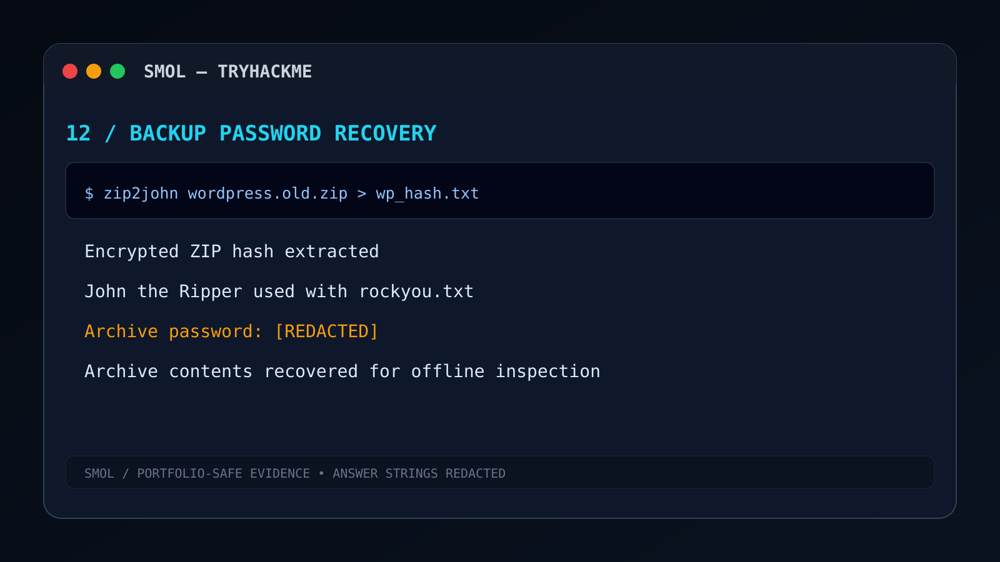

*Figure 13. Offline analysis of archive access credentials. Password values remain redacted.*

### Reported outcome

The source reports that archive analysis recovered historical configuration and additional authentication information. Exact filenames, archive commands, password values, and recovered contents are not supplied in full and are not reconstructed.

### Security significance

A backup can remain a credential repository even after a production password or configuration has changed. If archived credentials are still valid, their exposure can enable further access.

### Defensive controls

- Encrypt sensitive backups and protect their keys separately.
- Restrict backup storage permissions.
- Remove secrets that are not needed in archived copies.
- Apply retention and secure deletion policies.
- Audit access to backup archives.
- Rotate credentials when a backup containing secrets is exposed.

---

## Phase XII — Additional User Discovery

The original notes describe examining historical configuration and recovering additional user-related authentication information.

### Figure 14 — Historical Configuration

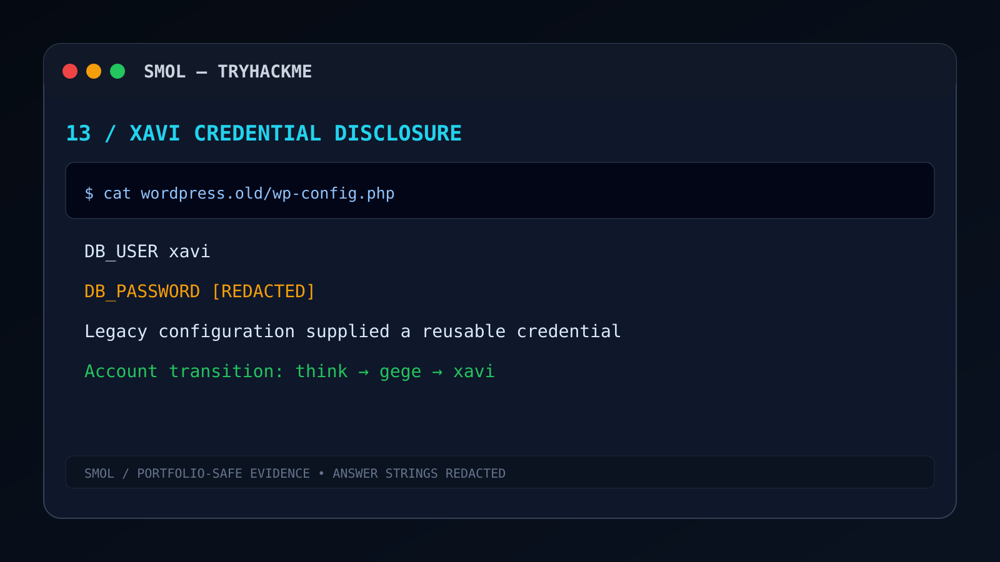

*Figure 14. Historical configuration review. Sensitive values remain redacted.*

### Reported investigation areas

| Discovery area | Assessment relevance |
|---|---|
| User home directories | Identify accounts and file-access boundaries |
| Historical configuration | Investigate potentially reusable authentication material |
| SSH-related files | Review authentication relationships |
| Archive metadata | Understand the origin and contents of historical artifacts |

The source reports discovery of an additional Linux user and successful expansion of user access through credential reuse and SSH authentication. The underlying credentials and exact user-to-user transition are not reproduced.

### Documented trust progression

<div class="attack-chain">
  <div class="attack-step">WordPress Access</div>
  <div class="attack-arrow">→</div>
  <div class="attack-step">Credential Discovery</div>
  <div class="attack-arrow">→</div>
  <div class="attack-step">SSH Authentication</div>
  <div class="attack-arrow">→</div>
  <div class="attack-step">Backup Review</div>
  <div class="attack-arrow">→</div>
  <div class="attack-step">Additional User Context</div>
</div>

This phase is relevant because access to a single web application may expose authentication material belonging to other users or services. Each transition must be assessed in terms of the specific credential, its permissions, and its intended scope.

---

## Phase XIII — Privilege Escalation

The final phase describes local privilege enumeration and the reported abuse of excessive sudo permissions to obtain root access.

### Figure 15 — Privilege Escalation

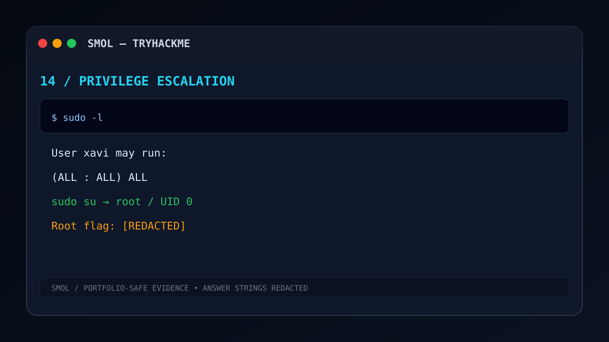

*Figure 15. Root privilege escalation evidence. Sensitive terminal output has been removed.*

### Documented escalation flow

<div class="attack-chain">
  <div class="attack-step">Authenticated Linux User</div>
  <div class="attack-arrow">→</div>
  <div class="attack-step">Local Enumeration</div>
  <div class="attack-arrow">→</div>
  <div class="attack-step">sudo Review</div>
  <div class="attack-arrow">→</div>
  <div class="attack-step">Excessive Privilege</div>
  <div class="attack-arrow">→</div>
  <div class="attack-step">Privileged Execution</div>
  <div class="attack-arrow">→</div>
  <div class="attack-step">Root</div>
</div>

### Enumeration areas

| Area | Purpose |
|---|---|
| sudo permissions | Identify commands a user may execute with elevated privileges |
| SUID binaries | Identify programs with special user-ID execution behavior |
| Linux capabilities | Review granular process privileges |
| User groups | Identify inherited access and permissions |
| Writable files | Investigate potential paths to privileged execution |

These are the enumeration categories listed in the original notes. The exact sudo rule, privileged binary, and exploitation command are not provided in the source material, so they are not inferred.

### Reported result

<div class="key-finding">
  <div class="key-finding-title">Root Access Reported</div>
  The source attributes final privilege escalation to excessive sudo
  permissions and reports successful root access. The precise misconfiguration
  and privileged execution path require the original terminal evidence for
  independent verification.
</div>

### Root verification commands

The original walkthrough lists:

```bash
whoami
id
hostnamectl
```

The reported verification output includes:

```text
root
uid=0(root)
```

The excerpt does not include the full output of `id` or `hostnamectl`. No additional identifiers or system details are inferred.

### Security impact

Root-level access can permit broad access to protected files, system configuration, service controls, account management, and other administrative functions. The exact capabilities depend on the host and its configuration.

### Defensive controls

- Review sudoers rules for excessive permissions.
- Apply the Principle of Least Privilege.
- Restrict privileged commands to the minimum required set.
- Audit changes to sudoers files and privileged executables.
- Review SUID permissions and Linux capabilities.
- Monitor privileged command execution and unexpected changes to system configuration.

---

## Consolidated Findings

The following table consolidates the findings explicitly described in the original notes. Severity labels are preserved only where the source provides them, and no CVSS scores or vulnerability identifiers have been added.

| ID | Finding | Source-reported severity | Documented impact |
|---|---|---|---|
| F-01 | Local File Inclusion in `jsmol2wp` | High in the detailed finding | Local file disclosure and access to WordPress configuration |
| F-02 | WordPress configuration disclosure | High | Exposure of database credentials and authentication-related secrets |
| F-03 | Hidden PHP backdoor in Hello Dolly | Critical in the detailed finding | Unexpected server-side execution functionality |
| F-04 | Remote code execution | Critical in the detailed finding | Operating-system commands executed in the web-server context |
| F-05 | Credential and password-hash exposure | High in the source risk summaries | Offline password analysis and potential credential reuse |
| F-06 | SSH authentication-material exposure | High in the source risk summaries | Potential unauthorized user authentication |
| F-07 | Backup archive credential disclosure | High in the source risk summaries | Exposure of historical configuration and authentication material |
| F-08 | Excessive sudo permissions | Critical in the source risk summaries | Reported escalation to root |

The source also discusses user enumeration, WordPress version and plugin metadata, and XML-RPC availability as additional observations. These are not assigned independent severity ratings here.

### Finding prioritization

<div class="ctf-card-grid">
  <div class="ctf-card">
    <div class="ctf-card-title">Priority 1 — Execution</div>
    <div class="ctf-card-value">Remove the backdoor, eliminate the vulnerable execution path, and investigate the host for compromise.</div>
  </div>
  <div class="ctf-card">
    <div class="ctf-card-title">Priority 2 — Secrets</div>
    <div class="ctf-card-value">Rotate exposed credentials, revoke affected SSH keys, and secure database and backup access.</div>
  </div>
  <div class="ctf-card">
    <div class="ctf-card-title">Priority 3 — Privileges</div>
    <div class="ctf-card-value">Correct excessive sudo permissions and audit privileged execution.</div>
  </div>
</div>

These priorities are remediation recommendations derived from the documented attack chain, not a formal CVSS-based risk calculation.

---

## MITRE ATT&CK Context

The original documentation names several ATT&CK tactics and techniques but does not supply technique IDs or supporting raw evidence for every mapping. The table below therefore describes the reported activity without inventing technique identifiers or claiming a fully validated mapping.

| Tactic or activity | Reported behavior | Evidence limitation |
|---|---|---|
| Reconnaissance | Network and service discovery | Nmap command is documented; raw output is incomplete |
| Initial Access | Exploitation of a public-facing WordPress application | LFI is reported; the exact HTTP request is absent |
| Execution | Operating-system command execution through PHP | Command-execution validation is reported |
| Credential Access | Configuration, database, and SSH material discovery | Sensitive values are redacted |
| Discovery | Filesystem and user enumeration | Enumeration workflow is described |
| Lateral Movement | SSH authentication into another Linux user context | Exact authentication command and identities are withheld |
| Privilege Escalation | Abuse of excessive sudo permissions | Exact sudo rule and privileged binary are not supplied |
| Impact | Reported root access | Verification excerpt contains `root` and `uid=0(root)` |

The original notes also mention server-side scripts, archive collection, and persistence-related implications. Those implications should not be treated as proof that persistence was established or that every listed ATT&CK technique was independently demonstrated.

---

## Defensive Recommendations

The remediation plan below is tied to the reported weaknesses and their place in the attack chain.

### WordPress and plugin security

| Finding | Recommended control |
|---|---|
| Vulnerable `jsmol2wp` plugin | Patch or remove the affected plugin; validate file paths and restrict local file access |
| Hidden PHP backdoor | Compare plugin files with trusted versions, remove unauthorized code, and investigate the host |
| WordPress configuration exposure | Restrict access to configuration files and rotate exposed secrets |
| User enumeration | Review whether public user discovery is necessary and apply appropriate access controls |
| XML-RPC availability | Disable or restrict XML-RPC if the deployment does not require it |

### Credential and backup security

| Finding | Recommended control |
|---|---|
| Database credential exposure | Rotate credentials and restrict database access to required services |
| Password-hash exposure | Protect authentication stores and use appropriate password-hashing configurations |
| SSH key exposure | Revoke or rotate affected keys and correct filesystem permissions |
| Credential reuse | Enforce unique credentials and use MFA where supported |
| Backup secrets | Restrict and encrypt archives, remove unnecessary secrets, and enforce retention policies |

### Linux privilege management

| Finding | Recommended control |
|---|---|
| Excessive sudo permissions | Remove unnecessary rules and enforce least privilege |
| Privileged binary abuse | Audit sudo rules, SUID binaries, and Linux capabilities |
| Web-server command execution | Investigate process creation, filesystem access, and outbound connections |
| Root-level compromise | Investigate system integrity, unauthorized accounts, scheduled tasks, services, and authentication changes |

### Monitoring and detection

| Detection area | Suggested monitoring |
|---|---|
| Plugin integrity | Detect unauthorized changes to PHP files and plugin directories |
| PHP execution | Investigate web-server processes spawning shells or unusual child processes |
| File inclusion | Alert on suspicious traversal patterns and unexpected access to configuration files |
| SSH authentication | Review login events, key usage, and anomalous sessions |
| sudo activity | Audit privileged command execution and sudoers changes |
| Backup access | Monitor unusual reads, extraction activity, and access by service accounts |
| Credential exposure | Rotate affected secrets and investigate their subsequent use |

### Remediation roadmap

<div class="ctf-card-grid">
  <div class="ctf-card">
    <div class="ctf-card-title">Immediate</div>
    <div class="ctf-card-value">Remove malicious code, patch vulnerable components, investigate compromise, and rotate exposed credentials.</div>
  </div>
  <div class="ctf-card">
    <div class="ctf-card-title">Short Term</div>
    <div class="ctf-card-value">Correct filesystem permissions, secure backups, review SSH access, and reduce excessive sudo permissions.</div>
  </div>
  <div class="ctf-card">
    <div class="ctf-card-title">Ongoing</div>
    <div class="ctf-card-value">Maintain plugin integrity monitoring, centralized logging, vulnerability management, and secret-management practices.</div>
  </div>
</div>

---

## Evidence Gallery

The original SVG image paths are preserved relative to `docs/index.md`.

### Reconnaissance and enumeration


*Figure 01. Original cover illustration.*


*Figure 02. Network reconnaissance.*


*Figure 03. Web directory enumeration.*


*Figure 04. WordPress plugin enumeration.*

### Exploitation and initial access


*Figure 05. Configuration disclosure with sensitive values redacted.*


*Figure 06. PHP backdoor source analysis.*


*Figure 07. Remote command execution evidence.*


*Figure 08. Interactive shell evidence.*

### Credentials and lateral movement


*Figure 09. WordPress authentication-record investigation.*


*Figure 10. Offline password-recovery workflow.*


*Figure 11. SSH authentication material, redacted.*


*Figure 12. Backup archive discovery.*


*Figure 13. Archive password-recovery evidence, redacted.*


*Figure 14. Historical configuration review.*

### Privilege escalation


*Figure 15. Root privilege-escalation evidence.*

---

## Lessons Learned

### Offensive security

- Enumerating WordPress plugins can expose attack paths not visible from the initial network scan.
- A file-inclusion vulnerability can expose configuration information that creates additional opportunities for compromise.
- Unexpected PHP execution functionality can turn application access into operating-system command execution.
- Credential discovery and SSH access can extend the impact beyond the original web-server account.
- Historical backup files can preserve secrets and configuration that are no longer required.
- Excessive sudo permissions can convert ordinary user access into administrative compromise.

### Defensive security

- Third-party plugin integrity is part of the application's security boundary.
- Configuration files, database records, SSH keys, and backups require explicit access controls.
- Password reuse increases the impact of a credential leak.
- Least-privilege controls must apply to both service accounts and interactive users.
- Detection should correlate application changes, process execution, filesystem access, authentication events, and privileged commands.

### Reporting and methodology

This case study illustrates why a penetration testing report should connect each major finding to evidence, impact, and remediation. A clear attack chain helps readers understand not only which weaknesses were present but also how their combined effect increased the scope of compromise.

---

## References

The source documentation names the following resources. No external URLs, version-specific advisories, or CVE identifiers were supplied.

- MITRE ATT&CK Framework
- OWASP Web Security Testing Guide
- WordPress Security Documentation
- GTFOBins — Linux privilege-escalation reference

### Tools referenced in the assessment

| Tool | Documented purpose |
|---|---|
| Nmap | Network and service enumeration |
| Gobuster | Directory enumeration |
| WPScan | WordPress enumeration |
| Netcat | Reverse-shell listener |
| Python | PTY stabilization |
| SSH | Remote user authentication |
| `zipinfo` / `unzip` | Backup archive analysis |
| John / Hashcat | Offline password-recovery methodology |

---

## Repository Contents

The original document identifies the following repository resources:

<div class="ctf-card-grid">
  <div class="ctf-card">
    <div class="ctf-card-title">GitHub Pages</div>
    <div class="ctf-card-value">`docs/index.md` — portfolio landing page and technical case study</div>
  </div>
  <div class="ctf-card">
    <div class="ctf-card-title">Documentation</div>
    <div class="ctf-card-value">`Documentation/Documentation.md` — referenced technical report</div>
  </div>
  <div class="ctf-card">
    <div class="ctf-card-title">Learning Notes</div>
    <div class="ctf-card-value">`Resources/notes.md` — referenced command notes and learning material</div>
  </div>
  <div class="ctf-card">
    <div class="ctf-card-title">Evidence Assets</div>
    <div class="ctf-card-value">`docs/assets/img/` — original SVG illustrations and evidence</div>
  </div>
</div>

These paths are retained as references from the source documentation; their presence in the current repository has not been independently verified.

---

## Responsible Use

> This documentation was prepared for authorized cybersecurity training and CTF environments. Techniques described here should only be used against systems for which explicit permission has been granted. Credentials, private keys, password hashes, and challenge flags are intentionally redacted in this portfolio version.

